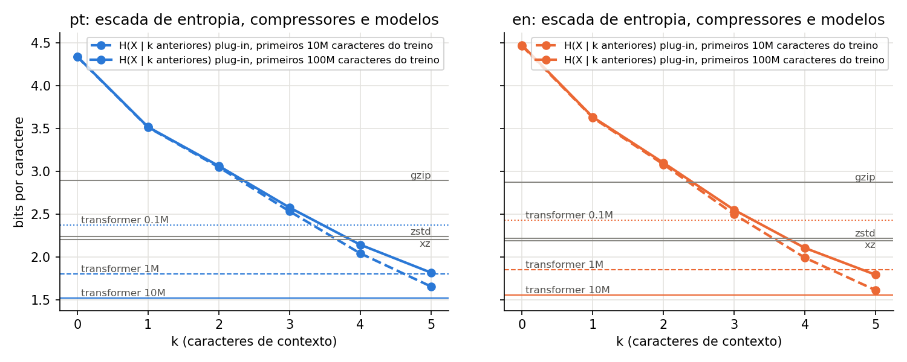
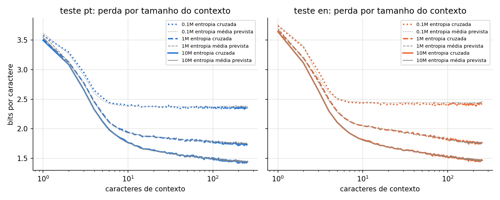
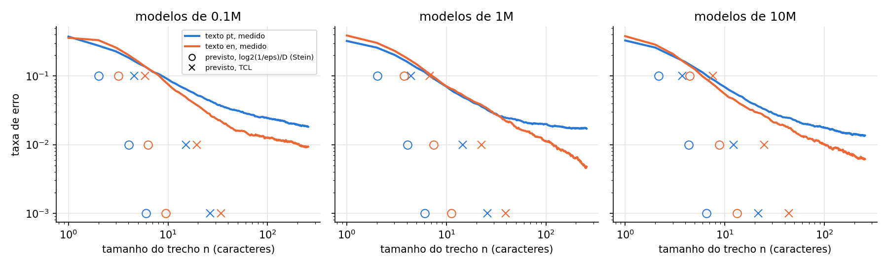

# Resultados: compressão = previsão, com transformers minúsculos em nível de caractere

Ideia: um modelo treinado com perda de entropia cruzada é um
compressor; a codificação aritmética guiada pelas probabilidades do modelo transforma −log2 q(x) bits por símbolo
em um arquivo de verdade. Mostramos isso com modelos próprios na Wikipédia em português (pt) e inglês (en).

Unidade em todo o documento: **bits por caractere** do texto normalizado (seção 1). Todo número abaixo vem de um
arquivo em `results/` e é impresso por `tables.py`; o nome do script que
gerou cada resultado está no título de cada seção. As figuras estão em `figures/` e são geradas por `figures.py`.
Para refazer este arquivo: `bash make_results.sh` (não edite abaixo do marcador à mão). O código está todo nesta
pasta, um script por etapa.

<!-- tables.py output below -->
## 1. Dados (`prepare_data.py`, `results/stats.json`)

Wikipédia da Hugging Face (`wikimedia/wikipedia`), dumps `20231101.pt` (os 6 arquivos parquet) e `20231101.en` (arquivos 0, 8, 16, 24, 32 e 40 de 41). Normalização (com perda, de propósito): NFKD, acentos e outras marcas combinantes removidos (ç → c), tudo em minúsculas, aspas curvas e « » viram `"` ou `'`, travessões viram `-`, e todo caractere fora de a–z, 0–9, espaço, quebra de linha e `. , ; : ! ? ' " - ( )` é descartado (49 símbolos; log2(49) = 5,61 bits/caractere é o teto "sem modelo"). Um parágrafo por linha, artigos separados por uma linha vazia. Filtros: artigos com menos de 2000 caracteres normalizados são descartados (esboços e a maioria dos artigos feitos por robôs); duplicatas exatas e quase-duplicatas (iguais depois de trocar todo dígito por 0) também. Os artigos são ordenados por md5("língua:id") e distribuídos para teste, depois validação, depois treino: os conjuntos são disjuntos por artigo, e cada um tem exatamente o mesmo tamanho nas duas línguas (o último artigo é cortado).

|  | pt | en |
|---|---|---|
| artigos lidos | 1.112.246 | 937.729 |
| descartados, < 2000 caracteres | 813.669 | 514.174 |
| descartados, duplicata | 12 | 2 |
| mantidos (caracteres) | 298.565 (1.998.485.840) | 423.553 (2.955.279.103) |
| teste: caracteres (artigos) | 10.000.000 (1.449) | 10.000.000 (1.521) |
| validação: caracteres (artigos) | 5.000.000 (778) | 5.000.000 (748) |
| treino: caracteres (artigos) | 400.000.000 (59.490) | 400.000.000 (57.191) |

## 2. Referências sem rede neural

**Escada de entropia** (`ngram_entropy.py`, `results/ngram.json`): entropia condicional "plug-in" H(X_n | k caracteres anteriores) = H((k+1)-gramas) − H(k-gramas), contando n-gramas nos primeiros N caracteres do treino, para N = 10M e N = 100M. A estimativa plug-in é viesada para baixo quando há muitos contextos distintos em relação a N; comparar os dois N mostra a partir de qual k isso acontece. **Compressores** (`compressors.sh`, `results/compressors.tsv`): gzip, xz e zstd nos arquivos de teste normalizados (10 MB por língua); bits/caractere = 8 × bytes comprimidos / caracteres.

| k | pt, N = 10M | pt, N = 100M | en, N = 10M | en, N = 100M |
|---|---|---|---|---|
| 0 | 4,335 | 4,337 | 4,461 | 4,470 |
| 1 | 3,512 | 3,516 | 3,624 | 3,631 |
| 2 | 3,048 | 3,062 | 3,079 | 3,098 |
| 3 | 2,532 | 2,577 | 2,496 | 2,548 |
| 4 | 2,042 | 2,143 | 1,990 | 2,104 |
| 5 | 1,656 | 1,818 | 1,611 | 1,791 |

| compressor | pt bytes | pt bits/caractere | en bytes | en bits/caractere |
|---|---|---|---|---|
| `gzip -9` | 3.614.182 | 2,891 | 3.589.601 | 2,872 |
| `xz -9e` | 2.756.368 | 2,205 | 2.731.952 | 2,186 |
| `zstd -19 --long=27` | 2.796.722 | 2,237 | 2.772.562 | 2,218 |

## 3. Modelos (`model.py`, `train.py`, `runs/*.log.json`)

Transformer só-decodificador mínimo, escrito à mão em PyTorch: tokens são caracteres, contexto de 256, três tamanhos por língua (cerca de 0,1M, 1M e 10M parâmetros). Cada modelo é treinado por exatamente uma época: cada trecho de 256 caracteres do treino (400M caracteres) é visto uma vez, em ordem aleatória (semente 0), lotes de 64 trechos, AdamW, taxa de aprendizado com aquecimento e decaimento cosseno, bf16. **Comprimento de código prequencial:** cada lote é avaliado ANTES da atualização feita com ele; a soma dessas perdas é o comprimento de código dos dados de treino sem cobrar nada pelos pesos (um decodificador que conhece a semente e a receita refaz as mesmas atualizações). Validação: os 5M caracteres de val.txt. As curvas de validação na figura usam só os primeiros 0,5M caracteres de val.txt.

| modelo | parâmetros | prequencial, bits/caractere (400M de treino) | validação final, bits/caractere | minutos | VRAM máx. (GB) |
|---|---|---|---|---|---|
| pt_0.1M | 122.801 | 2,5225 | 2,4055 | 5 | 0,17 |
| en_0.1M | 122.801 | 2,5998 | 2,4253 | 5 | 0,17 |
| pt_1M | 1.036.977 | 1,9694 | 1,8153 | 16 | 0,51 |
| en_1M | 1.036.977 | 2,0166 | 1,8694 | 16 | 0,51 |
| pt_10M | 9.977.649 | 1,6780 | 1,5286 | 82 | 1,82 |
| en_10M | 9.977.649 | 1,7368 | 1,5649 | 82 | 1,82 |

## 4. Entropia cruzada no teste, calibração e perda por posição (`evaluate.py`, `runs/eval/summary.json`)

Cada arquivo de teste (10M caracteres) é cortado em trechos de 256 caracteres sem sobreposição, e cada trecho é avaliado sem nenhum contexto anterior a ele: a posição i prevê o caractere i+1 a partir dos caracteres 0..i (float32, sem AMP). **Calibração:** a entropia média da distribuição prevista pelo modelo comparada com a entropia cruzada real; se as duas coincidem, o modelo sabe o quanto não sabe. **Perda por posição:** entropia cruzada média em cada posição do trecho, ou seja, em função de quantos caracteres de contexto o modelo tinha.

| modelo | texto de teste | bits/caractere | entropia média prevista | entropia − bits/caractere |
|---|---|---|---|---|
| pt_0.1M | pt | 2,3695 | 2,3877 | 0,0181 |
| pt_0.1M | en | 3,4774 | 3,0796 | -0,3978 |
| en_0.1M | pt | 4,0239 | 2,8387 | -1,1852 |
| en_0.1M | en | 2,4288 | 2,4532 | 0,0245 |
| pt_1M | pt | 1,7994 | 1,8078 | 0,0084 |
| pt_1M | en | 2,7362 | 2,5673 | -0,1689 |
| en_1M | pt | 3,4297 | 2,6562 | -0,7735 |
| en_1M | en | 1,8498 | 1,8469 | -0,0029 |
| pt_10M | pt | 1,5227 | 1,5243 | 0,0017 |
| pt_10M | en | 2,3112 | 2,1977 | -0,1135 |
| en_10M | pt | 3,0479 | 2,6711 | -0,3768 |
| en_10M | en | 1,5589 | 1,5615 | 0,0026 |

## 5. Codificação aritmética (`coder.py`, `runs/coder/*.json`)

Codificador aritmético inteiro próprio (registradores de 32 bits, Witten–Neal–Cleary). As probabilidades do modelo são quantizadas em frequências inteiras somando 2^16: f = 1 + piso(p·(2^16 − 49)), o resto vai para o símbolo mais provável. O texto é dividido em 512 fluxos contíguos que avançam juntos, um caractere por passo, cada um com uma janela deslizante dos últimos 256 caracteres. Codificador e decodificador rodam exatamente o mesmo laço (float32, algoritmos determinísticos), então veem frequências idênticas bit a bit. Teste: codificar e decodificar o primeiro 1 MB do teste e comparar. "Ideal" = Σ −log2 q_quantizada; "real" = tamanho do arquivo, incluindo o cabeçalho (8 bytes + 4 bytes por fluxo = 2056 bytes). Esta política de contexto (janela deslizante, até 255 caracteres de contexto) é diferente da política por trechos da seção 4, então os números não são idênticos aos de lá.

| modelo | ida e volta | bytes do arquivo | real, bits/caractere | ideal, bits/caractere | real − ideal | codificação (s) | decodificação (s) |
|---|---|---|---|---|---|---|---|
| pt_0.1M | OK | 298.837 | 2,3907 | 2,3719 | 0,0188 | 123 | 131 |
| en_0.1M | OK | 304.167 | 2,4333 | 2,4146 | 0,0188 | 124 | 131 |
| pt_1M | OK | 223.354 | 1,7868 | 1,7681 | 0,0188 | 395 | 402 |
| en_1M | OK | 226.502 | 1,8120 | 1,7934 | 0,0187 | 398 | 401 |
| pt_10M | OK | 186.210 | 1,4897 | 1,4709 | 0,0187 | 2287 | 2272 |
| en_10M | OK | 189.510 | 1,5161 | 1,4972 | 0,0188 | 2288 | 1571 |

## 6. Matriz entre línguas (`evaluate.py`, `runs/eval/summary.json`)

Os mesmos números da seção 4, organizados como matriz: cada texto de teste (mesmo tamanho nas duas línguas) codificado pelo modelo da própria língua e pelo da outra. "en pelo pt" = texto de teste em inglês codificado pelo modelo português. O excesso CE(en | modelo pt) − CE(en | modelo en) estima KL(p_en‖q_pt) − KL(p_en‖q_en); as duas direções são mostradas porque não precisam ser iguais.

| tamanho | pt pelo pt | en pelo en | en pelo pt | pt pelo en | excesso no texto en (modelo pt − modelo en) | excesso no texto pt (modelo en − modelo pt) |
|---|---|---|---|---|---|---|
| 0.1M | 2,3695 | 2,4288 | 3,4774 | 4,0239 | 1,0486 | 1,6544 |
| 1M | 1,7994 | 1,8498 | 2,7362 | 3,4297 | 0,8864 | 1,6303 |
| 10M | 1,5227 | 1,5589 | 2,3112 | 3,0479 | 0,7523 | 1,5252 |

## 7. Identificação de língua: uma previsão testada (`lid.py`, `runs/lid.json`)

Para um trecho na língua A, a razão de log-verossimilhança por caractere é L_i = log2 q_A(x_i) − log2 q_B(x_i) (B = a outra língua); o trecho é classificado como A quando Σ L_i > 0. Na primeira metade dos trechos de teste medimos a média D e o desvio padrão de L_i e prevemos quantos caracteres n são necessários para errar com probabilidade eps: pelo lema de Stein, n ≈ log2(1/eps)/D; pelo teorema central do limite (tratando os L_i como independentes), n ≈ (z_eps · desvio / D)². A segunda metade (texto disjunto) dá o erro medido da regra para cada n = 1..256, usando como amostra os primeiros n caracteres de cada trecho de 256. "n medido" = menor n com erro ≤ eps; — = não alcançado em 256 caracteres. Inspeção dos trechos de teste com maior erro (modelos de 0,1M): no texto pt, listas de anos sem palavras ("1834 1835 1836 ..."); no texto en, listas de títulos de livros em português dentro de artigos da Wikipédia em inglês.

| tamanho | texto | D (bits/caractere) | desvio | eps | n previsto, Stein | n previsto, TCL | n medido | erro medido com n = 256 |
|---|---|---|---|---|---|---|---|---|
| 0.1M | pt | 1,655 | 2,763 | 0,1 | 2,0 | 4,6 | 9 | 0,0182 |
| 0.1M | pt | 1,655 | 2,763 | 0,01 | 4,0 | 15,1 | — | 0,0182 |
| 0.1M | pt | 1,655 | 2,763 | 0,001 | 6,0 | 26,6 | — | 0,0182 |
| 0.1M | en | 1,052 | 1,992 | 0,1 | 3,2 | 5,9 | 9 | 0,0093 |
| 0.1M | en | 1,052 | 1,992 | 0,01 | 6,3 | 19,4 | 208 | 0,0093 |
| 0.1M | en | 1,052 | 1,992 | 0,001 | 9,5 | 34,2 | — | 0,0093 |
| 1M | pt | 1,634 | 2,682 | 0,1 | 2,0 | 4,4 | 7 | 0,0172 |
| 1M | pt | 1,634 | 2,682 | 0,01 | 4,1 | 14,6 | — | 0,0172 |
| 1M | pt | 1,634 | 2,682 | 0,001 | 6,1 | 25,7 | — | 0,0172 |
| 1M | en | 0,887 | 1,807 | 0,1 | 3,7 | 6,8 | 8 | 0,0048 |
| 1M | en | 0,887 | 1,807 | 0,01 | 7,5 | 22,5 | 118 | 0,0048 |
| 1M | en | 0,887 | 1,807 | 0,001 | 11,2 | 39,6 | — | 0,0048 |
| 10M | pt | 1,530 | 2,307 | 0,1 | 2,2 | 3,7 | 7 | 0,0136 |
| 10M | pt | 1,530 | 2,307 | 0,01 | 4,3 | 12,3 | — | 0,0136 |
| 10M | pt | 1,530 | 2,307 | 0,001 | 6,5 | 21,7 | — | 0,0136 |
| 10M | en | 0,751 | 1,611 | 0,1 | 4,4 | 7,6 | 6 | 0,0061 |
| 10M | en | 0,751 | 1,611 | 0,01 | 8,8 | 24,9 | 101 | 0,0061 |
| 10M | en | 0,751 | 1,611 | 0,001 | 13,3 | 43,9 | — | 0,0061 |

## 8. Comprimento de descrição (`mdl.py`, `results/mdl.json`)

Quatro maneiras de contar bits por caractere para o mesmo modelo, com pesos a 32 bits cada: **modelo compartilhado** = entropia cruzada no teste (o receptor já tem o modelo, como um dicionário); **duas partes, teste** = (32 × parâmetros + 10M × bits/caractere no teste) / 10M, isto é, mandar os pesos junto com o arquivo de teste de 10 MB; **duas partes, treino** = o mesmo para os 400M caracteres de treino, usando a perda de validação final como perda no treino (uma época, cada caractere visto uma vez); **prequencial** = seção 3, sem custo pelos pesos. Referência citada, não executada: o recorde do Hutter Prize é 110.793.128 bytes para o enwik9 (fx2-cmix, set/2024) = 0,886 bits por byte de XML bruto, descompressor incluído; não é comparável com estes números (outro texto, outro alfabeto, outro tamanho).

| modelo | pesos (Mbit) | modelo compartilhado | duas partes, 10M de teste | duas partes, 400M de treino | prequencial, 400M de treino |
|---|---|---|---|---|---|
| pt_0.1M | 3,9 | 2,3695 | 2,7625 | 2,4153 | 2,5225 |
| en_0.1M | 3,9 | 2,4288 | 2,8217 | 2,4351 | 2,5998 |
| pt_1M | 33,2 | 1,7994 | 5,1178 | 1,8982 | 1,9694 |
| en_1M | 33,2 | 1,8498 | 5,1681 | 1,9524 | 2,0166 |
| pt_10M | 319,3 | 1,5227 | 33,4516 | 2,3268 | 1,6780 |
| en_10M | 319,3 | 1,5589 | 33,4878 | 2,3631 | 1,7368 |

## 9. Verificação de sanidade: text8 (`text8_data.sh`, `results/runs_text8/text8_1M.log.json`)

text8 = primeiros 10^8 caracteres do enwik9 limpos para a–z e espaço; divisão padrão 90M treino / 5M validação / 5M teste. O modelo de 1M foi treinado uma época nos 90M de treino com a mesma receita; o número "teste" abaixo é a avaliação final nos 5M de teste (guardados como val.txt). Resultados publicados no text8 em nível de caractere ficam em torno de 1,1–1,5 bits/caractere, com modelos maiores treinados por muitas épocas.

| modelo | parâmetros | prequencial, bits/caractere (90M de treino) | teste, bits/caractere (5M) | minutos |
|---|---|---|---|---|
| text8_1M | 1.036.977 | 2,1388 | 1,8741 | 2 |

