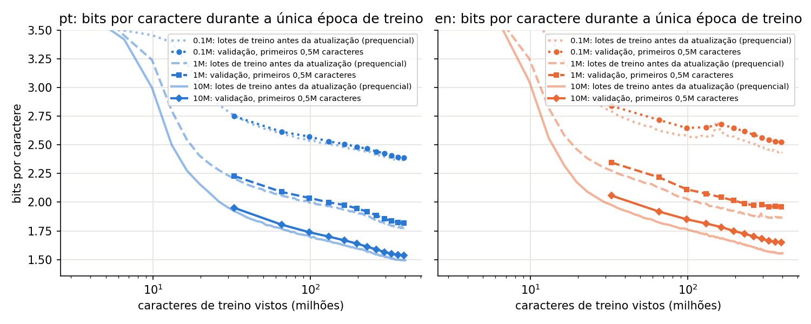

# Resultados

Um modelo de linguagem treinado com entropia cruzada também é um compressor. Aqui mostramos isso com transformers que
escrevemos e treinamos na Wikipédia em português (pt) e em inglês (en).

Em todo o documento, a unidade é bits por caractere, ou bpc, do texto normalizado descrito na seção 1. Cada número
vem de um arquivo em `results/` e é impresso por `src/tables.py`; o título de cada seção diz qual script gerou os
resultados dela. As figuras ficam em `figures/` e são geradas por `src/figures.py`.

Para refazer este arquivo, rode `bash src/make_results.sh`. Não edite à mão nada abaixo do marcador, porque o
script reescreve essa parte.

<!-- tables.py output below -->
## 1. Dados (`prepare_data.py`, `results/stats.json`)

Usamos os dumps da Wikipédia de 1º de novembro de 2023 publicados no Hugging Face (`wikimedia/wikipedia`). Do
português (`20231101.pt`) entram os 6 arquivos Parquet, e do inglês (`20231101.en`) entram os arquivos 0, 8, 16, 24,
32 e 40 de 41.

A normalização perde informação de propósito, para que as duas línguas usem o mesmo alfabeto. Aplicamos a
normalização Unicode NFKD, que separa cada letra do seu acento, e jogamos os acentos fora (assim "ç" vira "c").
Depois passamos tudo para minúsculas, trocamos aspas curvas e « » por `"` ou `'` e travessões por `-`, e descartamos
qualquer caractere fora de a–z, 0–9, espaço, quebra de linha e `. , ; : ! ? ' " - ( )`.

Sobram 49 símbolos. Sem modelo nenhum, com todos os símbolos igualmente prováveis, cada caractere custaria
log2(49) ≈ 5,61 bits, e esse é o teto de referência para todos os números abaixo.

No texto final, cada linha é um parágrafo, e uma linha vazia separa um artigo do outro. Descartamos os artigos com
menos de 2000 caracteres depois da normalização, que em geral são stubs ou artigos criados por bots. Também
descartamos duplicatas exatas e quase-duplicatas, isto é, artigos que só diferem nos dígitos.

Para dividir o corpus, ordenamos os artigos pelo hash MD5 de "língua:id" e os distribuímos, nessa ordem, para teste,
validação e treino. Assim nenhum artigo aparece em dois conjuntos, e o treino é uma amostra aleatória do que
sobrou. Cada conjunto tem exatamente o mesmo número de caracteres nas duas línguas, e para isso cortamos o último
artigo de cada um.

|  | pt | en |
|---|---|---|
| artigos lidos | 1.112.246 | 937.729 |
| descartados, < 2000 caracteres | 813.669 | 514.174 |
| descartados, duplicata | 12 | 2 |
| mantidos (caracteres) | 298.565 (1.998.485.840) | 423.553 (2.955.279.103) |
| teste: caracteres (artigos) | 10.000.000 (1.449) | 10.000.000 (1.521) |
| validação: caracteres (artigos) | 5.000.000 (778) | 5.000.000 (748) |
| treino: caracteres (artigos) | 400.000.000 (59.490) | 400.000.000 (57.191) |

## 2. Baselines sem rede neural

A primeira referência é a entropia condicional por tamanho de contexto, que chamamos de *entropy ladder*
(`ngram_entropy.py`, `results/ngram.json`). Ela responde quanto custa o próximo caractere quando conhecemos os k
anteriores. Contamos n-gramas (sequências de n caracteres) nos primeiros N caracteres do treino, com N = 10M e
N = 100M, e calculamos H(X_n | k caracteres anteriores) = H((k+1)-gramas) − H(k-gramas).

Essa é a estimativa plug-in, que usa as frequências observadas como se fossem as probabilidades verdadeiras. Quando
há muitos contextos diferentes em comparação com N, a maioria aparece poucas vezes, e a estimativa fica baixa
demais. Comparar N = 10M com N = 100M mostra a partir de qual k isso começa a acontecer.

A segunda referência são os compressores de uso geral (`compressors.sh`, `results/compressors.tsv`). Comprimimos os
arquivos de teste normalizados (10 MB por língua) com gzip, xz e zstd. Se um arquivo de N caracteres vira B bytes, o
custo é 8B/N bpc.

| k | pt, N = 10M | pt, N = 100M | en, N = 10M | en, N = 100M |
|---|---|---|---|---|
| 0 | 4,335 | 4,337 | 4,461 | 4,470 |
| 1 | 3,512 | 3,516 | 3,624 | 3,631 |
| 2 | 3,048 | 3,062 | 3,079 | 3,098 |
| 3 | 2,532 | 2,577 | 2,496 | 2,548 |
| 4 | 2,042 | 2,143 | 1,990 | 2,104 |
| 5 | 1,656 | 1,818 | 1,611 | 1,791 |

| compressor | pt bytes | pt bpc | en bytes | en bpc |
|---|---|---|---|---|
| `gzip -9` | 3.614.182 | 2,891 | 3.589.601 | 2,872 |
| `xz -9e` | 2.756.368 | 2,205 | 2.731.952 | 2,186 |
| `zstd -19 --long=27` | 2.796.722 | 2,237 | 2.772.562 | 2,218 |

## 3. Modelos (`model.py`, `train.py`, `runs/*.log.json`)

O modelo é um transformer decoder-only pequeno, escrito do zero em PyTorch. Cada token é um caractere, e o contexto
tem 256 caracteres. Treinamos três tamanhos por língua, com cerca de 0,1M, 1M e 10M de parâmetros.

Cada modelo treina por uma única época, então cada trecho de 256 caracteres do corpus de treino (400M de
caracteres) aparece uma vez, em ordem aleatória (seed 0). Usamos batches de 64 trechos, AdamW, learning rate com
warmup e cosine decay, e bf16.

Durante o treino também medimos o prequential code length. Antes de atualizar os pesos com um batch, calculamos a
loss do modelo nesse batch, que ele ainda não viu. Somando essas losses no treino inteiro, temos o tamanho de um
código para os dados de treino que não paga nada pelos pesos. Isso vale porque um decodificador que conhece a seed
e a receita de treino consegue refazer as mesmas atualizações.

A validação usa os 5M de caracteres de val.txt. As curvas de validação da figura usam só os primeiros 0,5M, e os
números finais da tabela usam os 5M.

| modelo | parâmetros | prequential code length, bpc (400M de treino) | validação final, bpc | minutos | VRAM máx. (GB) |
|---|---|---|---|---|---|
| pt_0.1M | 122.801 | 2,5225 | 2,4055 | 5 | 0,17 |
| en_0.1M | 122.801 | 2,5998 | 2,4253 | 5 | 0,17 |
| pt_1M | 1.036.977 | 1,9694 | 1,8153 | 16 | 0,51 |
| en_1M | 1.036.977 | 2,0166 | 1,8694 | 16 | 0,51 |
| pt_10M | 9.977.649 | 1,6780 | 1,5286 | 82 | 1,82 |
| en_10M | 9.977.649 | 1,7368 | 1,5649 | 82 | 1,82 |

## 4. Entropia cruzada no teste, calibração e loss por posição (`evaluate.py`, `runs/eval/summary.json`)

Cortamos cada arquivo de teste (10M de caracteres) em trechos de 256 caracteres, sem sobreposição. Cada trecho é
avaliado sozinho, sem o texto que vem antes dele, e a posição i prevê o caractere i+1 a partir dos caracteres 0..i.
Aqui tudo roda em float32, sem mixed precision.

O modelo também diz o quanto está incerto, por meio da entropia da distribuição que ele prevê. Para medir a
calibração, comparamos a média dessa entropia com a entropia cruzada medida de fato. Quando as duas coincidem, a
incerteza que o modelo declara é a incerteza real. Quando a entropia prevista é menor, o modelo está confiante
demais.

Por fim, calculamos a entropia cruzada média em cada posição do trecho. Essa loss por posição mostra quanto o
modelo ganha a cada caractere a mais de contexto.

| modelo | texto de teste | bpc | entropia média prevista | entropia − bpc |
|---|---|---|---|---|
| pt_0.1M | pt | 2,3695 | 2,3877 | 0,0181 |
| pt_0.1M | en | 3,4774 | 3,0796 | -0,3978 |
| en_0.1M | pt | 4,0239 | 2,8387 | -1,1852 |
| en_0.1M | en | 2,4288 | 2,4532 | 0,0245 |
| pt_1M | pt | 1,7994 | 1,8078 | 0,0084 |
| pt_1M | en | 2,7362 | 2,5673 | -0,1689 |
| en_1M | pt | 3,4297 | 2,6562 | -0,7735 |
| en_1M | en | 1,8498 | 1,8469 | -0,0029 |
| pt_10M | pt | 1,5227 | 1,5243 | 0,0017 |
| pt_10M | en | 2,3112 | 2,1977 | -0,1135 |
| en_10M | pt | 3,0479 | 2,6711 | -0,3768 |
| en_10M | en | 1,5589 | 1,5615 | 0,0026 |

## 5. Codificação aritmética (`coder.py`, `runs/coder/*.json`)

Implementamos nosso próprio codificador aritmético, com inteiros de 32 bits, no esquema clássico de Witten, Neal e
Cleary. A cada passo, o modelo dá uma distribuição sobre os 49 símbolos, e o codificador gasta cerca de −log2 q bits
no caractere que de fato aparece.

O ponto delicado é que o codificador e o decodificador precisam ver exatamente as mesmas probabilidades. Uma
diferença no último bit de um float já corrompe todo o resto do arquivo. Por isso os dois rodam o mesmo laço, em
float32 e com algoritmos determinísticos. As probabilidades viram frequências inteiras que somam 2^16, com
f = 1 + piso(p·(2^16 − 49)), e a sobra vai para o símbolo mais provável.

O texto é dividido em 512 streams contíguos, processados em paralelo, um caractere por passo. Cada stream usa uma
janela deslizante com os últimos 256 caracteres. Para testar, codificamos o primeiro 1 MB do teste, decodificamos e
comparamos com o original (round trip).

O tamanho ideal é a soma Σ −log2 q_quantizada. O tamanho real é o tamanho do arquivo, incluindo um cabeçalho de 2056
bytes (8 bytes mais 4 bytes por stream). A diferença entre os dois é o overhead do codificador.

Aqui o contexto vem de uma janela deslizante (até 255 caracteres antes), e não de trechos independentes como na
seção 4. Por isso os números desta seção não são exatamente iguais aos de lá.

| modelo | round trip | bytes do arquivo | real, bpc | ideal, bpc | real − ideal | codificação (s) | decodificação (s) |
|---|---|---|---|---|---|---|---|
| pt_0.1M | OK | 298.837 | 2,3907 | 2,3719 | 0,0188 | 123 | 131 |
| en_0.1M | OK | 304.167 | 2,4333 | 2,4146 | 0,0188 | 124 | 131 |
| pt_1M | OK | 223.354 | 1,7868 | 1,7681 | 0,0188 | 395 | 402 |
| en_1M | OK | 226.502 | 1,8120 | 1,7934 | 0,0187 | 398 | 401 |
| pt_10M | OK | 186.210 | 1,4897 | 1,4709 | 0,0187 | 2287 | 2272 |
| en_10M | OK | 189.510 | 1,5161 | 1,4972 | 0,0188 | 2288 | 1571 |

## 6. Matriz entre línguas (`evaluate.py`, `runs/eval/summary.json`)

Esta seção reorganiza os números da seção 4 em uma matriz. Cada texto de teste, com o mesmo tamanho nas duas
línguas, é codificado pelo modelo da própria língua e pelo modelo da outra. Por exemplo, "en pelo pt" é o texto em
inglês codificado pelo modelo treinado em português.

A intuição vem da identidade H(P,Q) = H(P) + KL(P‖Q), que diz que usar o modelo errado custa bits extras. O excesso
CE(en | modelo pt) − CE(en | modelo en), em que CE é a entropia cruzada, estima KL(p_en‖q_pt) − KL(p_en‖q_en). Aqui
p_en é a distribuição verdadeira do inglês e q é a distribuição de cada modelo. Mostramos as duas direções porque a
divergência KL não é simétrica.

| tamanho | pt pelo pt | en pelo en | en pelo pt | pt pelo en | excesso no texto en (modelo pt − modelo en) | excesso no texto pt (modelo en − modelo pt) |
|---|---|---|---|---|---|---|
| 0.1M | 2,3695 | 2,4288 | 3,4774 | 4,0239 | 1,0486 | 1,6544 |
| 1M | 1,7994 | 1,8498 | 2,7362 | 3,4297 | 0,8864 | 1,6303 |
| 10M | 1,5227 | 1,5589 | 2,3112 | 3,0479 | 0,7523 | 1,5252 |

## 7. Identificação de língua como previsão testada (`lid.py`, `runs/lid.json`)

A ideia é usar os dois modelos para descobrir em que língua um trecho está. Para um trecho escrito na língua A,
calculamos para cada caractere a razão de log-verossimilhança L_i = log2 q_A(x_i) − log2 q_B(x_i), em que B é a outra
língua. A regra classifica o trecho como A quando Σ L_i > 0, ou seja, quando o modelo de A comprime o trecho melhor.

Primeiro fazemos uma previsão. Na primeira metade dos trechos de teste, medimos a média D e o desvio padrão de L_i, e
estimamos quantos caracteres n são necessários para errar com probabilidade eps. O lema de Stein dá
n ≈ log2(1/eps)/D. O teorema central do limite (TCL), tratando os L_i como independentes, dá
n ≈ (z_eps · desvio / D)², em que z_eps é o quantil da normal padrão para 1 − eps.

Depois medimos. Na segunda metade, que é texto diferente, calculamos o erro real da regra para cada n de 1 a 256,
usando os primeiros n caracteres de cada trecho. O "n medido" é o menor n com erro ≤ eps, e "—" quer dizer que esse
erro não foi alcançado em 256 caracteres.

Olhamos também os trechos de teste com mais erros (modelos de 0,1M). No texto em português, eles são listas de anos
sem palavras ("1834 1835 1836 ..."). No texto em inglês, são listas de títulos de livros em português dentro de
artigos da Wikipédia em inglês.

| tamanho | texto | D (bpc) | desvio | eps | n previsto, Stein | n previsto, TCL | n medido | erro medido com n = 256 |
|---|---|---|---|---|---|---|---|---|
| 0.1M | pt | 1,655 | 2,763 | 0,1 | 2,0 | 4,6 | 9 | 0,0182 |
| 0.1M | pt | 1,655 | 2,763 | 0,01 | 4,0 | 15,1 | — | 0,0182 |
| 0.1M | pt | 1,655 | 2,763 | 0,001 | 6,0 | 26,6 | — | 0,0182 |
| 0.1M | en | 1,052 | 1,992 | 0,1 | 3,2 | 5,9 | 9 | 0,0093 |
| 0.1M | en | 1,052 | 1,992 | 0,01 | 6,3 | 19,4 | 208 | 0,0093 |
| 0.1M | en | 1,052 | 1,992 | 0,001 | 9,5 | 34,2 | — | 0,0093 |
| 1M | pt | 1,634 | 2,682 | 0,1 | 2,0 | 4,4 | 7 | 0,0172 |
| 1M | pt | 1,634 | 2,682 | 0,01 | 4,1 | 14,6 | — | 0,0172 |
| 1M | pt | 1,634 | 2,682 | 0,001 | 6,1 | 25,7 | — | 0,0172 |
| 1M | en | 0,887 | 1,807 | 0,1 | 3,7 | 6,8 | 8 | 0,0048 |
| 1M | en | 0,887 | 1,807 | 0,01 | 7,5 | 22,5 | 118 | 0,0048 |
| 1M | en | 0,887 | 1,807 | 0,001 | 11,2 | 39,6 | — | 0,0048 |
| 10M | pt | 1,530 | 2,307 | 0,1 | 2,2 | 3,7 | 7 | 0,0136 |
| 10M | pt | 1,530 | 2,307 | 0,01 | 4,3 | 12,3 | — | 0,0136 |
| 10M | pt | 1,530 | 2,307 | 0,001 | 6,5 | 21,7 | — | 0,0136 |
| 10M | en | 0,751 | 1,611 | 0,1 | 4,4 | 7,6 | 6 | 0,0061 |
| 10M | en | 0,751 | 1,611 | 0,01 | 8,8 | 24,9 | 101 | 0,0061 |
| 10M | en | 0,751 | 1,611 | 0,001 | 13,3 | 43,9 | — | 0,0061 |

## 8. Comprimento de descrição (`mdl.py`, `results/mdl.json`)

Uma objeção natural é que o modelo também precisa ser enviado para que o arquivo possa ser decodificado. Por isso
contamos os bpc de cada modelo de quatro maneiras, sempre com cada peso custando 32 bits.

Com o modelo compartilhado, o custo é a entropia cruzada no teste, como se quem recebe o arquivo já tivesse o modelo,
do mesmo jeito que acontece com um dicionário. No two-part code de teste, enviamos os pesos junto com o arquivo de
teste de 10 MB, e o custo é (32 × parâmetros + 10M × bpc no teste) / 10M.

O two-part code de treino faz a mesma conta para os 400M caracteres de treino. Como loss no treino usamos a loss de
validação final, já que o modelo viu cada caractere do treino uma única vez. O prequential code length, por fim, é o
valor da seção 3, que não paga nada pelos pesos.

Como referência, citamos sem executar o recorde do Hutter Prize, que é de 110.793.128 bytes para o enwik9 (fx2-cmix,
setembro de 2024), ou 0,886 bits por byte de XML bruto, já contando o descompressor. Esse número não é comparável
com os nossos, porque o texto, o alfabeto e o tamanho são outros.

| modelo | pesos (Mbit) | modelo compartilhado | two-part, 10M de teste | two-part, 400M de treino | prequential, 400M de treino |
|---|---|---|---|---|---|
| pt_0.1M | 3,9 | 2,3695 | 2,7625 | 2,4153 | 2,5225 |
| en_0.1M | 3,9 | 2,4288 | 2,8217 | 2,4351 | 2,5998 |
| pt_1M | 33,2 | 1,7994 | 5,1178 | 1,8982 | 1,9694 |
| en_1M | 33,2 | 1,8498 | 5,1681 | 1,9524 | 2,0166 |
| pt_10M | 319,3 | 1,5227 | 33,4516 | 2,3268 | 1,6780 |
| en_10M | 319,3 | 1,5589 | 33,4878 | 2,3631 | 1,7368 |

## 9. Verificação de sanidade com o text8 (`text8_data.sh`, `results/runs_text8/text8_1M.log.json`)

O text8 é um benchmark clássico, formado pelos primeiros 10^8 caracteres do enwik9 (um trecho da Wikipédia em
inglês) limpos para conter só a–z e espaço. A divisão padrão usa 90M de caracteres para treino, 5M para validação e
5M para teste.

Treinamos o modelo de 1M de parâmetros por uma época nos 90M de treino, com a mesma receita dos outros modelos. O
número "teste" abaixo é a avaliação final nos 5M de teste, guardados como val.txt.

Resultados publicados no text8 em character-level ficam em torno de 1,1 a 1,5 bpc, mas vêm de modelos maiores,
treinados por muitas épocas. Este teste serve só como verificação de sanidade do nosso pipeline.

| modelo | parâmetros | prequential code length, bpc (90M de treino) | teste, bpc (5M) | minutos |
|---|---|---|---|---|
| text8_1M | 1.036.977 | 2,1388 | 1,8741 | 2 |

